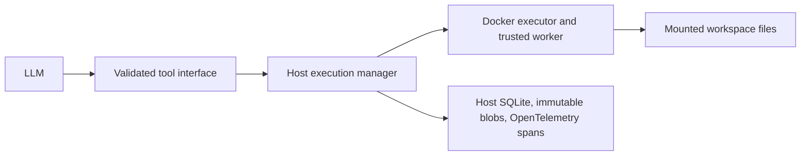

# Docker execution lifecycle

Models can request missing tooling through a separate preparation phase; see
[model-requested environments](environment-preparation.md). This does not enable
networking in ordinary execution containers.

See also: [executor/README.md](executor/README.md) — developer guide for the executor package.

Container lifecycle belongs to the host harness. The LLM proposes tools; it cannot
choose Docker mounts, privileges, image IDs, or lifecycle operations.



## Modes and configuration

**Ephemeral** is the compatibility default: create an invocation container, run
the tool, publish its result, commit the result, then remove the container.

**Persistent** creates one keeper per workspace and executes each tool through
`docker exec`. Repeated calls reuse the keeper and its `/tmp` state. Each call is
a new process: shell exports and `cd` do not carry over. Working directories are
explicit workspace-relative paths; the host execution API accepts a validated
per-call environment. Dependencies and important artifacts belong in the mounted
workspace, for example a project virtual environment, rather than container state.
New persistent keepers are created with a `local-agent.role=task` label; role
labels are diagnostic metadata only and never grant authority. See
[model capability probes](model-capability-probes.md) for the probe role and
container naming.

### Why choose one mode over the other?

| Concern | Ephemeral | Persistent |
| --- | --- | --- |
| Container lifetime | Fresh container per invocation | Compatible keeper reused between calls |
| Mounted workspace files | Preserved on the host | Preserved on the host |
| Container `/tmp` | Lost when the container is removed | Retained until cleanup or container removal |
| Background processes | End with the container | Can keep running between calls |
| Main benefit | Clean execution without earlier container-local state | Less startup overhead and continuity for servers and temporary setup |

Use ephemeral execution when you want each call to rely on the prepared image
and saved workspace. Persistent execution is useful for iterative development,
such as keeping a development server running across several tool calls.
Independent checks and reviews use ephemeral containers to avoid depending on
the coding keeper's temporary state. Workspace files can still carry state
between ephemeral calls; ephemeral execution does not reset the project.

Neither mode increases the model's conversation memory. Saved code, container
state, and model context have separate lifetimes. See
[context and helpers](context-helpers.md) for request construction and trimming.

### Temporary files and persistence

`/tmp` is temporary space inside the container, separate from the host's `/tmp`
and from `/workspace`. The executor mounts it as a **128 MiB tmpfs**, backed by
memory, with `nosuid,nodev,noexec`. It also sets `HOME=/tmp`, so tools using the
home directory may put their settings or caches there.

Depending on the commands and libraries used, it can contain browser test
profiles, temporary test files, compiler scratch files, downloaded/unpacked files,
and home-directory caches. These are examples, not files that every run creates.
Important deliverables and dependencies should use the mounted workspace or a
prepared image rather than relying on `/tmp`.

Ephemeral containers lose `/tmp` when removed. Persistent keepers retain it
between calls, but tools may delete their own files earlier, and expiry, stopping,
or replacing the keeper discards it. Losing `/tmp` does not delete the project
under `/workspace/project`. It also does not remove similarly named files in the
host's `/tmp`.

The mount and default environment are defined in
[docker.py](../src/local_agent/executor/docker.py), with command environments
constructed in [worker.py](../src/local_agent/executor/worker.py). For host-to-container
workspace paths, see [where worktrees live](git-workspaces.md#where-worktrees-live-and-how-docker-sees-them).

### Configuration example

Add this block to an existing agent YAML (including `coder.yaml` or `analog.yaml`):

```yaml
execution:
  execution_mode_default: persistent
  max_execution_seconds: 300
  persistent_container_idle_timeout: 1800
  max_persistent_containers: 4
  container_memory_limit: 4096
  container_cpu_limit: 4
  container_network_enabled: false
```

| Setting | Default | Meaning / accepted range |
|---|---:|---|
| `execution_mode_default` | `ephemeral` | `ephemeral` or `persistent` |
| `max_execution_seconds` | 300 | Command timeout cap, 1–300 seconds |
| `persistent_container_idle_timeout` | 1800 | Idle expiry, 1–86400 seconds |
| `max_persistent_containers` | 4 | Capacity per data-root owner, 1–64 |
| `container_memory_limit` | 4096 | MiB, 64–4096 |
| `container_cpu_limit` | 4 | Integer CPU equivalents, 1–4 |
| `container_pids_limit` | 128 | Linux tasks (processes and threads), integer 64–1024 |
| `container_network_enabled` | false | Current offline policy rejects `true` |

Omitting `execution` preserves existing behavior. To explicitly select ephemeral
mode, use `execution: {execution_mode_default: ephemeral}`. The same run command
works in either mode:

```bash
uv run --locked local-agent run \
  --agent config/coder.yaml --repo /path/to/repo --task-file task.md
```

The browser also offers an **Execution mode** selector for tool-enabled profiles.
Choose the profile default, ephemeral, or persistent for the submitted job;
the effective mode is saved with the job and reply, without rewriting the YAML.
See [browser execution mode](browser.md#execution-mode).
The browser configuration editor accepts this block as well. Changes affect
future runs; recovery uses the original frozen configuration. Persistent mode is
opt-in for coding until its behavior has been evaluated on your tasks.

New tasks import a new workspace. Git task continuation reuses the previous
worktree and a compatible healthy keeper, with a fresh run ID for each attempt.
The keeper's name includes its owner/workspace identity. Legacy UUID-named idle
keepers are renamed on reuse, retaining the same container ID. Snapshot leases
pause/unpause the keeper while host baselines and completion checks/candidates
are captured; `/tmp` and background processes survive continuation. Background
jobs are suspended during these guards, including the bounded independent checks.
Incompatible image/resource settings, expiry or an unhealthy keeper cause replacement.
Resuming an interrupted run retains its workspace and recovery semantics.
The execution manager can reuse the same workspace across run IDs.
Workspace locks serialize commands and cleanup; different workspaces never share
keepers. The existing one-coding-run-per-data-root lease remains in effect.
Trusted bootstrap, diff export, independent checks and review copies use ephemeral
containers and do not accumulate persistent keepers during repeated iterations.

## Host ownership, cleanup, and recovery

The manager records CREATED, STARTING, RUNNING, EXECUTING, IDLE, STOPPING,
STOPPED, FAILED, and REMOVED states. It keeps atomic host-only manifests and
cross-process locks under `<data-root>/control/containers/`.

Ownership requires the data-root owner label, mode, workspace, exact container
ID, and security attestation. Names alone are not authority. Ephemeral containers
retain the `local-agent.run`, `local-agent.execution`, and `local-agent.workspace`
labels. Persistent keepers use owner/mode/workspace labels; changing run and
execution IDs are attached to execution records rather than immutable labels.

Persistent execution starts a detached host reaper. It checks expiry roughly
once per second, survives the initiating CLI process, skips locked workspaces,
and exits after no owned keepers remain. A subsequent persistent run restarts it.
After a host restart, the next persistent run or an explicit cleanup sweep
reconciles owned idle/orphaned containers. A stopped keeper is recreated; an
interrupted active command is never silently replayed.

```bash
uv run --locked local-agent containers list
uv run --locked local-agent containers cleanup
uv run --locked local-agent containers stop --workspace ws_<32-hex-digits>
```

Supply `--data-root /path/to/root` **before** `containers` when using another
data root. `cleanup` expires idle containers and reconciles owned orphans;
`stop` explicitly removes the selected keeper. Workspace files remain intact.

Timeout, cancellation, and output-limit violations terminate the whole execution
container, including descendants. A later persistent call creates a replacement.
An ordinary nonzero command exit retains a healthy keeper. Resource or image
configuration changes can require explicitly stopping an old keeper before reuse.

Every command publishes a durable result marker before SQLite commits its
outcome. Recovery first uses that result. A keeper's logs or exit code cannot
establish an individual `docker exec` outcome: without a published result,
persistent recovery stops the matching old execution, records an unknown
outcome, and requires reconciliation. It does not infer success or rerun mutations.

## Traces and results

The **host**, including the host reaper, writes authoritative traces; Docker jobs
do not receive the control directory. By default records live in
`~/.local/share/local-agent/control/`, or the selected MCP/browser data root.

The common result includes run/execution/workspace/tool-call/container IDs,
command argv, mode, UTC start/end times, duration, status/error, exit code, and
separate immutable stdout/stderr blob references. Previews remain bounded.
`control/attempts/<execution_id>.container.json` binds an attempt to its container;
the adjacent `<execution_id>.json` points to its published result.

Use the existing trace UI (`./traces`) or CLI:

```bash
uv run --locked local-agent trace RUN_ID --json
uv run --locked local-agent report RUN_ID
uv run --locked local-agent audit RUN_ID
```

Lifecycle events carry correlation IDs and share the current OpenTelemetry
boundary. Results remain after removal. Cleanup after a completed run uses a
separate `host-maintenance` audit run with originating IDs, preserving completed
run immutability. Maintenance does not call an LLM or represent a verified task
success. Empty polling sweeps do not create audit runs. Cleanup failures are
recorded and are not reported as successful removals.

Explicit environment values are transmitted through worker stdin and excluded
from lifecycle manifests/events and Docker arguments. Commands and captured
output remain evidence; a program that prints a secret puts it in that output.

## Provisioning and isolation

```bash
uv sync --locked
uv run --locked local-agent build-sandbox
uv run --locked local-agent doctor
uv run --locked pytest --docker-image "$(python3 -c 'import json;print(json.load(open("config/sandbox.json"))["image"])')"
```

The build pins the base/image digests and trusted worker fingerprints in
`config/sandbox.json`. Rebuild after worker changes. Both modes retain non-root
UID/GID, read-only root, offline networking, no GPU/devices/Docker socket,
dropped capabilities, no privilege escalation, default seccomp, no swap,
an operator-bounded task limit (128 by default), a 128 MiB `/tmp` tmpfs, and exactly one scoped workspace mount.
The host attests Docker settings; the worker checks actual cgroup protections.

Tools run from a fixed trusted image path. Workspace import rejects symlinks and
special files; file tools use descriptor traversal and `O_NOFOLLOW`. Arbitrary
commands still have the granted workspace authority. Persistent mode does not
enable global package installation or network downloads.

Output has a combined 10 MiB cap and a 16 KiB preview. Workspace disk protection
is a soft monitor (1 GiB / 100,000 entries) during executions, not a filesystem
quota; idle background processes are not continuously disk-monitored. Docker
shares the host kernel. Persistence improves state retention and startup costs;
it does not by itself improve a model's reasoning or verified task success rate.


`run_command.cwd` selects a directory inside Docker. `cwd: "project"` maps to
`/workspace/project`; omitting it uses the task directory. It is not a command or
a host path. `argv` runs directly without shell expansion, so environment settings
use an executable such as `env`. The host validates the tool request before Docker
runs it, then returns captured output, exit status and retained-evidence references
to the model. Validation errors return corrective feedback without execution.


## Process/thread exhaustion

For a browser-heavy task you can set the limit in the browser profile editor:

```yaml
execution:
  execution_mode_default: persistent
  container_pids_limit: 256
```

This changes future runs, not a running or frozen attempt. Model tool arguments
cannot raise it. Memory and CPU grants remain separate. Threads count toward
Docker's PID limit, so free RAM does not imply available task slots.

The host samples the inspected container's cgroup `pids.current`, `pids.max`,
`pids.events`, and optionally `pids.peak`. Historical peaks or old rejected-fork
counts alone do not turn an ordinary exit 1 into a resource failure. A full cgroup
or a newly rejected fork on a failed execution produces `process_limit`, a clear
error, resource measurements, and `execution.resource_limited` evidence. This
works when the full container cannot start another worker. For remote daemons,
Docker stats provide a full-container fallback on failure; short-lived spikes
cannot always be measured when host cgroup access is unavailable.

An exhausted persistent keeper is removed. Its workspace files and selected
immutable environment image remain; the next new command creates a keeper with
that image. The failed command is **never automatically replayed**, and arbitrary
command side effects remain unknown. Published results are reconciled after an
interruption; missing results still require reconciliation.

Prepared images from older workers remain usable with the default 128-task
setting. To use a different limit with an old prepared image, start a new task
from the desired workspace commit and prepare its environment using the current
sandbox worker. The harness reports this incompatibility before dispatching a
continuation. New headless preparations install a launcher with immediate
`--help` and process-group cleanup, including launcher SIGKILL. Refresh an old
launcher by requesting `prepare_environment` with `headless_browser` again.
Browser test clients should use unique profiles and CDP ports, wait for readiness,
and terminate and await `harness-browser` in a finally block. Raw Chromium shell
wrappers do not provide the launcher's cleanup guarantees.
