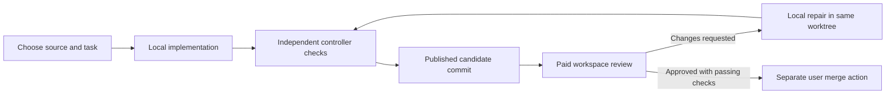

# Functional instruction manual

Use this manual to operate the harness from the browser and understand what each
action changes. Setup options and implementation details are linked where needed.

For installation, start with the [CLI quick start](tldr.md). Use the
[browser reference](browser.md) to look up a control, [key concepts](key-concepts.md)
for terminology, and [reviews](reviews.md) for what data goes to paid models.

## The workflow

The intended division of work is: **the local model writes code and tests; the
paid model reviews a selected candidate and requests specific changes**. You
choose the task, limits, candidate to review, and whether to merge the result.



Failures can stop this flow before publication or approval. A diagram arrow does
not authorize paid calls: manual review needs an explicit action, and automatic
reviews need an authorized loop with available budget and eligible evidence.

## Open the browser

Start `./browser` from the harness checkout and open its printed URL. Enter the
pairing code printed by that server. If the launch redirects output to a log,
the code is in that log. A server restart generates a new code and requires
re-pairing. Keep pairing codes private.

Choose the profile for your task:

| Profile | Purpose |
| --- | --- |
| `browser.yaml` | General conversation and screenshot questions |
| `coder.yaml` | Implement or repair a project |
| `analog.yaml` | Investigate a circuit PDF |

This manual focuses on coding. See [browser setup](browser.md#starting-the-server),
[configuration](configs.md), and the [circuit workflow](circuits.md) for the other
options. A paid reviewer must be enabled and configured on the server; selecting
a reviewer alone does not start inference.

## Understand the identities

| Item | What it identifies | What it does not establish |
| --- | --- | --- |
| Source repository | Your original project checkout | That agent changes have been merged |
| Chat | A saved conversation containing submissions and results | One particular code version |
| Job ID | One browser submission | That the submission succeeded |
| Workspace ID, `ws_…` | A managed editable project checkout | That its current files are approved |
| Worktree and `agent/ws_…` branch | The workspace's Git checkout and agent branch | A second original source repository |
| Run ID, `run_…` | One agent attempt with its own trace and outcome | A new worktree every time |
| Candidate commit | A published, fixed version of the proposed code | Passing tests or reviewer approval |
| Container ID/name | A Docker execution environment or preview server | The model, code version, or verification result |

One workspace can have many runs and candidate commits. Its files are mutable;
a commit identifies a fixed version. A saved reply retains its original commit
details even if the worktree path now contains later edits.

## Start a new coding task

1. Select `coder.yaml` and the desired local model.
2. Set the source project directory to the repository root.
3. Choose **New task**. Leave **Starting revision** blank to start from the
   source checkout's committed `HEAD`, or select the intended branch/tag/commit.
4. Optionally choose a **Working subdirectory** inside that repository.
5. Describe the expected behavior, constraints, and acceptance criteria, then
   submit the task.

For an existing repository, staged, unstaged, and untracked source edits are
preserved but are not included in the starting candidate. If the chosen source
directory has no repository, the harness initializes one before creating the
managed worktree. Choose the enclosing repository root plus a working subdirectory
when you want to keep the enclosing repository's history.

The local model reads files, writes implementation and tests, and runs commands in
the selected Docker environment. The controller independently checks configured
tests before accepting normal completion. Missing dependencies, failed checks,
and stopping limits are reported. A successful attempt publishes a candidate;
your original checkout is not automatically switched or merged.
A published candidate can still have failed or blocked checks; publication itself
is not a passing result.

## When a new worktree is created

| Action | New retained coding worktree? | Result |
| --- | --- | --- |
| Submit a coding task with **New task** | Yes | New workspace ID and agent branch |
| Select a different starting revision for a new task | Yes, on submission | Separate candidate based on that revision |
| **Continue task**, **Continue this worktree**, or **Continue this workspace** | No | New run in the same worktree and branch |
| **Fix with local model** | No | Repair run against the selected reviewed workspace |
| Further local iterations of a repair loop | No | Further runs in that loop's workspace |
| Paid workspace review or independent checks | No retained coding worktree | Separate disposable copies of the selected candidate |
| Open a chat or choose **New chat** | No | Conversation changes only; submission starts work |
| Refresh a preview or restart the browser server | No | No new coding checkout |

**New task starts from the chosen source revision, not automatically from the
most recent agent worktree.** If an agent's feature is still unmerged, starting
another task from the source's `main` can start without that feature. Continue
the existing worktree when you want to build on its pending implementation.

For example: a new task creates workspace A and publishes commit C1. Local repair
keeps workspace A, starts another run, and can publish C2. A review of C2 uses
separate copies of C2. A new task against an unchanged source repository creates
workspace B from the original source revision, not C2.

## Continue or repair existing work

Use the saved chat's workspace panel or coding reply to choose the existing
worktree. **Continue this workspace** fills the controls; enter the follow-up and
submit it. Keep the source directory pointed at the original repository.

Continuation preserves current worktree files, including pending edits from a
failed attempt. It creates a new run ID and keeps previous results and evidence.
It does not approve those pending edits. A new starting revision cannot be
selected while continuing.

After a paid review requests changes, select the local coding profile/model and
choose **Fix with local model**. This opens repair options without starting a job.
Add optional priorities or constraints in **Additional repair context** (up to
4,000 characters), then choose **Start local repair**, or **Cancel** to close it.
The repair continues the reviewed workspace's existing worktree and agent branch;
it creates a new run, not a new worktree. The controller supplies the original task,
findings, acceptance criteria, and check output. You do not need to paste the
whole review or reconstruct its paths. The action itself does not start another
paid review or merge code.
Your additional context is retained in the submitted task and saved repair evidence.

The repair target must still match the saved review. If another attempt has
already moved the workspace, an old review's repair action can be rejected.
Continue the current worktree and inspect its latest attempt instead of assuming
an older reply still describes the current files.

Reviewed local repairs retain a progress ledger. Repeated probing or inspection
without advancing the repair triggers bounded recovery guidance. Continued lack
of progress stops as `local_stalled`, with work and evidence preserved. These
controls do not guarantee that generated tests exercise the required behavior.

## Review a candidate with a paid model

1. Open the chat containing the coding result.
2. Select **OpenAI reviewer (paid, optional)**.
3. Choose **Workspace — inspect files and run tests**, or expand **Verify this
   candidate** on the specific coding response.
4. Confirm the target candidate commit. Leave tests on **auto** and retain the
   task directory unless you need an explicit override.
5. Click **Verify workspace and run tests (paid)** or **Review workspace and run
   checks (paid)**, depending on which control you opened.

The reviewer reads the candidate diff, relevant code, tests and configuration;
discovers relevant suites; runs commands; and returns findings or approval with
limitations. The controller matches selected test commands to captured execution
evidence and repeats them in a fresh copy before approval. No manual test command
is normally required. Unsupported tooling or missing dependencies remain blockers.

**Conversation-only review** is advisory: it reviews chat content, cannot inspect
the candidate files or run tests, and does not approve a workspace for merging.

For exactly which code, chat excerpts, and test evidence reach the paid model,
including context caps and per-request usage, see [reviews and data sharing](reviews.md).
The reviewer inspects the selected candidate, not your live preview or a global
ranking of worktrees. Interactive flows are verified only when the report records
that they were actually exercised.

## Decide which version to use

There is no automatic global ranking of workspaces. Choose according to the
evidence for the version you need:

| Question | Evidence to inspect |
| --- | --- |
| Which attempt is most recent in this workspace? | **Current attempt**, run ID, and workspace history |
| Which version was published? | The coding result's **Candidate commit** |
| Which candidate passed checks? | Independent check results linked to that candidate's attempt |
| Which version was approved? | An approved workspace report's **Reviewed commit**, passing checks and audit evidence |
| What files exist now? | The current worktree, including any unpublished edits |
| What is in my original project? | The source checkout and its merged commit |

Match the review's **Reviewed commit** to the candidate you intend to use. A
newer failed attempt is not better than an older approved candidate. Approval of
C1 does not cover C2 or edits made after C1. **Latest attempt**, **latest passing
candidate**, and **last approved commit** are distinctions to make when reading
the evidence; they are not three automatic version selectors in the current UI.

For host-side inspection, these commands are read-only; substitute your paths:

```bash
git -C /path/to/source-repository worktree list
git -C /path/to/agent-worktree status --short
git -C /path/to/agent-worktree rev-parse HEAD
```

The worktree's `HEAD` alone does not include unpublished edits; check its status
as well. See [Git workspaces](git-workspaces.md) for deeper inspection.

## Know what a preview is showing

A project preview is a separate serving process. Starting a coding task does
not automatically create or switch that server. The harness browser interface
and the project's preview can be on different ports.

For a Docker-hosted preview, identify its URL/port and mounted source directory:

```bash
docker ps --format '{{.Names}}  {{.Ports}}'
docker inspect CONTAINER_NAME --format '{{range .Mounts}}{{.Source}} -> {{.Destination}}{{println}}{{end}}'
```

Replace `CONTAINER_NAME` with the preview container, not an agent tool container.
The mounted directory identifies the workspace being served. A live worktree
mount serves current files, including pending edits, even if the preview was
started before the latest run. Refreshing may also require clearing stale browser
assets. A port or container name alone does not establish approval.

To preview an exact approved version, serve a separate export of that approved
commit. The existing live-worktree preview is not automatically pinned when a
review approves a commit. The paid reviewer instead checks its exported candidate
in its own sandbox; a separate preview is not its authoritative code source.

## Use an automatic completion or approval loop

Choose **Loop until complete…** for local-only completion in the existing
workspace. The controller requires a published candidate from the current attempt,
passing configured checks, and valid attempt/check audits. It reports
**Complete — checks passed; not reviewer-approved.** This mode cannot invoke paid
review or diagnosis. Stop, interruption, stalling and exhausted budgets preserve
work. Neither loop mode automatically merges.

**Agent run limit — minutes** inherits the selected profile when blank; an override
applies to ordinary submissions, local review repairs and each loop attempt.
**Loop total budget — minutes** covers all attempts, preparation and checks. Each
stage is capped by its remaining time. The loop panel shows stages, cycles,
recovery status, elapsed/remaining time and final-attempt warnings. Continuation
attaches unresolved checks, a recovery plan and labelled host/sandbox history;
expand **Previous task context attached** to inspect it.

Choose **Loop until approved…** in the workspace panel, select the local model
and reviewer, and set the local-iteration, paid-attempt, token, and time limits.
Explicitly authorize paid stages when using them. Set paid attempts to zero for
local-only operation. Opening the controls alone does not start inference.

The loop reuses the coding worktree. Local attempts and review stages get their
own runs and evidence. Automatic paid review requires an audited published
candidate, audited passing independent checks, and new candidate content or
materially new verification evidence. Unchanged content and evidence cannot keep
triggering paid reviews merely because a new run or commit ID was created.

Loops can stop on approval, stalled work, duplicate review evidence, failed or
unavailable verification, or time/budget limits. Some failures lead to
further bounded local attempts; they do not constitute approval. When paid review
is unavailable and local checks pass, the result is `tests_passed_unverified`.
Any authorized advisory diagnosis consumes the existing paid allowance and does
not approve code. **Stop loop after current stage** prevents another stage from
being scheduled; the current bounded stage may finish.

Server restart interrupts active loops and does not automatically replay paid
requests. Inspect the saved state before explicitly starting another loop.
See [loop controls and limits](browser.md#workspace-sessions-and-bounded-loops).

## Read outcomes and investigate failures

| Outcome | Meaning |
| --- | --- |
| `editing` | Workspace contains an in-progress attempt; there may be unpublished edits |
| `ready_for_review` | A candidate was published; review is still needed |
| `completed_unverified` | Agent completed its attempt; this is not paid approval |
| Checks `passed` | Those recorded checks passed; coverage and behavior still need assessment |
| Review `changes_requested` | Reviewer found issues or insufficient evidence |
| Review `approved` | That exact candidate met the recorded review/check requirements |
| `local_stalled` | Local repair exhausted bounded recovery; work is retained |
| `review_blocked` | An automatic review was ineligible; read the recorded reason |
| `tests_passed_unverified` | Loop ended with passing tests but without approval of the latest version |
| `budget_exhausted` | A model-turn, tool-call, or time limit stopped the run |
| `needs_reconciliation` | An interrupted operation has an uncertain outcome; it must not be blindly repeated |

A browser job marked **completed** can contain a review that requests changes.
A job marked **failed** can have useful edits or successful test executions.
Read the separate run, check, and review outcomes rather than inferring them from
one badge. Protected-fixture `verified` results are distinct from ordinary project
review approval.

Open the workspace history and **View this attempt timeline**, or use **Show /
hide run timeline**. Inspect the stopping reason, repair stage, actual tool
arguments, and retained output. Successful probes can still be unproductive;
passing tests can still be weak tests. **Read full retained output** opens the
recorded evidence. Viewing a timeline does not start a model or test run.

Models run through the host-side provider. Docker runs their file/command tools.
Ephemeral containers are removed after calls, so no visible review container
while the model is thinking is normal. Persistent coding mode can retain a
compatible container across calls and continuation; an idle keeper is not an
active model command. Worktree files survive container removal. See
[runtime data](runtime-data.md) and [executor lifecycle](executor.md).

## Merge and manage cost

After approval, **Merge reviewed commit** is a separate action against the exact
reviewed commit. The source checkout must be clean and unchanged, and the browser
merge requires a safe fast-forward. If the source has advanced or the candidate
has changed, inspect the mismatch rather than resetting your source to bypass it.
Review, repair and previews do not automatically merge or push code.

Paid charges apply to model requests, not just the final visible report. A review
job can use several model/tool turns. Use the measured input/output counters;
input totals include repeated context. Reported reasoning is included in output,
not an extra total to add again. See [review token accounting](reviews.md#context-per-request-and-total-paid-usage).
Hypothetical GPT baselines are estimates, not
evidence that a paid model was called. A short visible answer alone does not
establish low paid output usage. See [repair policy and output allowances](local-repair-reliability.md).

Keep worktrees until you no longer need their files or pending edits. Stopping a
container does not require deleting a workspace. Retained trace evidence is
separate from the current code checkout. For storage, cleanup, backup and recovery,
use [runtime data](runtime-data.md) and [operations](operations.md).

For how local agents and paid reviewers run actual clicks, keyboard input and
persistence checks, see [browser verification and capability recovery](browser-verification.md).
The shared runner avoids optional-library discovery loops; missing tooling remains
a reported environment blocker. Project-specific regression coverage is still required.
