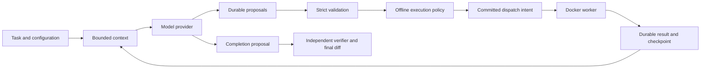

# Detailed implementation guide

This document describes the implemented harness. The original
[build guide](../local-agent-build-guide.md) explains the design and milestones;
[the five-minute guide](tldr.md) provides the short operational introduction.

## Architecture and the execution loop

The host controller creates a private workspace and protected baseline, resolves
configuration/model identity, and commits a run manifest. It performs a trusted
Git bootstrap, then builds bounded model context. The provider sends the exact
saved payload and captures the raw response before normalized proposals commit.
Each proposed call is validated, evaluated by deterministic policy, and bound to
an execution request through canonical hashes. Intent and started records commit
before the executor is invoked. Results commit before the next model turn.



The runtime is sequential. Multiple calls in one response execute in order, with
correlated results. Invalid calls receive structured errors; they still count
against attempted-call budgets. Repeated identical failures, turn/call limits,
and deadlines stop work. Trusted bootstrap, verifier and final-diff operations
have explicit `harness` requests and purposes. Additional workspaces require
protected grants; model arguments cannot select them.

Implementation entry points:

| Component | Source | Responsibility |
| --- | --- | --- |
| CLI | `src/local_agent/cli.py` | Runs, inspection, recovery, evaluation, browser |
| Runtime | `runtime/agent.py` | Sequential live orchestration |
| Contracts | `contracts.py` | Strict versioned records and tool inputs |
| Providers | `models/` | Native Ollama and OpenAI-compatible inference |
| Context | `runtime/context.py` | Exact payload, budgets, compaction lineage |
| Policy | `policy/engine.py` | Deterministic capabilities and hashes |
| Executor | `executor/docker.py`, `executor/lifecycle.py`, `executor/maintenance.py`, `executor/worker.py` | Container lifecycle and trusted in-image operations |
| Storage | `storage/database.py`, `storage/blobs.py` | Durable records and immutable evidence |
| Recovery | `runtime/recovery.py` | History restoration and reconciliation |
| Inspection | `observability/audit.py`, `observability/browser.py` | Read-only audit and browser traces |

## Installation and configuration

Run from this repository after installing uv and Docker. Use `uv sync --locked`
and `uv run --locked …`; `.python-version` selects the development interpreter and
`uv.lock` pins dependencies. This workstation's IDE PATH omits `~/.local/bin`, so
export it or use the absolute uv path.

`build-sandbox` provisions dependencies outside the model loop, records the
registry base digest and immutable image ID, and hashes the trusted worker and
verifier. Runtime refuses stale worker/verifier hashes. Rebuild after editing
those image files. Docker requires cgroup v2 and functioning limits; no host
executor fallback exists. Workspace imports reject symlinks/special files and
are bounded. Do not put the data root inside the repository being imported.

State defaults to `~/.local/share/local-agent`. Change it with a global option
before the command:

```bash
uv run --locked local-agent --data-root /path/to/private-state simulate
```

The coder YAML selects provider, exact model ID, tool allowlist, instructions
version/hash, execution profile, context/output budgets and runtime limits. The
resolved manifest stores actual instructions, task, policy, sandbox identity and
provider metadata. A filename alone is not configuration provenance.

## Model providers

The provider factory supports `ollama` and `openai`. `ScriptedProvider` is used by
simulation and tests. A provider chooses inference transport; it does not change
execution authority.

Native Ollama uses `/api/chat`, sends native tool schemas/messages and options,
and retains complete raw responses, optional thinking, token counts and durations.
The configured tag must match an installed model exactly. Ollama metadata can
identify the installed model digest.

The OpenAI adapter uses `/v1/chat/completions` and standard function tools.
Assistant calls contain provider IDs and string JSON arguments; tool results
include the corresponding `tool_call_id`. Exact serialized requests and raw
responses remain evidence. Malformed argument JSON becomes a rejected proposal;
malformed envelopes, HTTP errors, refusal and incomplete/truncated completion
statuses fail with retained raw response evidence. There are no hidden HTTP
retries. A restart retry for a missing persisted response is explicit in the trace.

Configuration for a hosted API:

```yaml
schema_version: 1
agent_id: coder
provider: openai
base_url: https://api.openai.com/v1
api_key_env: OPENAI_API_KEY
model: YOUR_EXACT_MODEL_ID
completion_token_field: max_completion_tokens
instructions_version: coder-v2
tools: [read_file, write_file, patch_file, list_files, search_files, run_command, git_diff]
policy_profile: dev-offline-v1
window_tokens: 8192
output_reserve_tokens: 2048
limits:
  max_model_turns: 30
  max_attempted_tool_calls: 100
  run_timeout_seconds: 1200
  model_timeout_seconds: 180
```

Set the key through your shell/secret manager. YAML contains only the variable
name; no credential value is stored in manifests, context, tool containers, or
model request blobs. HTTPS is required for remote endpoints. Plain HTTP is allowed
only on loopback. URL credentials, query parameters and fragments are rejected.
HTTP clients do not inherit proxy settings and do not follow redirects.

An OpenAI configuration sends context to its selected endpoint. The execution
profile's offline setting restricts tool containers, not host inference. The
adapter currently supports text and Chat Completions function tools; Responses,
multimodal input and streaming are separate future adapters. Output uses
`max_completion_tokens`; local compatibility servers can select `max_tokens`.
The configured window is a harness input budget, not a remotely set context size.
No sampling/reasoning parameters are silently imposed on OpenAI models.

`config/openai-local.yaml` targets Ollama's compatible `/v1` endpoint with the
selected Q8 model and no API key. It is useful for testing this transport locally.
For another compatible server, change the URL and exact model ID. Model-list
metadata is hashed for change detection but does not identify hosted model weights;
OpenAI runs explicitly report incomplete reproducibility.

Startup capability probes test real tool selection, schema adherence, result
continuation and stopping. Cache keys include provider/model metadata, endpoint,
image, schemas, instructions, context and output limits. Use
`doctor --agent PATH` to check the chosen provider. Model-list access and native
function calling are required by this initial adapter.

The implementation follows the official
[Chat Completions reference](https://developers.openai.com/api/reference/resources/chat/subresources/completions/methods/create).

## Tools and workspace authority

| Tool | Behavior |
| --- | --- |
| `read_file` | Bounded file lines with content hash, or authorized output bytes by evidence ref |
| `write_file` | Create-only write or replacement requiring the expected hash |
| `patch_file` | Replace exactly one match with an expected-hash precondition |
| `list_files` | Bounded traversal with depth/offset controls |
| `search_files` | Bounded literal search |
| `run_command` | Argv execution in Docker, timeout and capture limits; optional helper manifest |
| `git_diff` | Bounded diff with external diff/text conversion disabled |

Paths must begin with project, memory, tools, scratch or outputs. Empty, dot,
parent, absolute and backslash components are rejected. The worker opens files
relative to directory descriptors, without following symlinks, and rejects special
files. Atomic writes fsync data and directories. Generated code never imports into
host Python.

Containers mount only their workspace, run as the current non-root UID/GID, use
an offline network namespace and read-only image, drop all capabilities, and enable
no-new-privileges/seccomp. Limits are checked both through Docker inspection and
actual in-container kernel/cgroup values. No GPU devices, host credentials or
Docker socket are passed. Commands receive a minimal environment; the trusted host API can supply validated per-command additions.

Output streams are drained concurrently with a total 10 MiB capture cap and
16 KiB preview. Floods and timeouts terminate the container and descendants.
Workspace disk growth is monitored with cancellation; this is a soft bound,
not a hard filesystem/project quota. See [executor details](executor.md).

## Context, evidence and helpers

Each context snapshot includes exact ordered messages and tools, payload hash,
input estimate, provenance and exclusions. Fixed instructions/task survive
compaction. Selection operates on complete assistant/tool groups, never partial
call/result exchanges. Omitted groups are retained as evidence and referenced by
a deterministic derived index with hashes and preserved constraints. The index
is untrusted working memory. Provider input counts are reconciled against the
reserved input budget before dispatch; absent counts remain unknown.

Outputs expose explicit refs. `read_file(evidence_ref=..., byte_offset=...,
byte_limit=...)` resolves only committed same-run output/stream/artifact refs.
Knowing another blob hash or including it in model prose does not grant access.
Slices are byte-based; split UTF-8 boundaries use replacement decoding.

Helper manifests are untrusted JSON under tools. The initial interface accepts
an exact single-file Python entrypoint and `cwd="tools"`. The in-image worker
captures/hashes manifest and code and runs the captured bytes in isolated Python.
The result identifies hashes, declared version and immutable image. Requested
capabilities grant nothing. Sibling imports and broad shared-helper promotion
are not part of this interface. See [context and helper examples](context-helpers.md).

## Completion and protected verification

A no-tool response creates a completion proposal. General tasks without a verifier
end `completed_unverified`; model prose alone cannot earn `verified`. Supplied
verifiers check calculator/add, arithmetic mean and clamp behavior using protected
cases from the read-only image. Verification gets a fresh workspace containing
the candidate implementation. Editable project tests are useful for development,
but not independent proof.

The final diff is built in a fresh staging workspace against the protected source
baseline, so changes to the agent's Git history cannot hide edits. Artifacts retain
their producing execution, bytes and hash. Original repositories are not modified
and diffs are not automatically applied.

## Durability, recovery and cancellation

SQLite uses WAL, foreign keys and synchronous FULL. Publish/fsync immutable blobs
before committing references; failed transactions can leave orphan evidence.
Events and state changes share short transactions and causal edges. Execution
requests bind the exact normalized arguments, policy decision/hash, workspace,
limits, and request/context chain. A failed commit prevents dispatch.

One OS lease serializes coding runs per data root. Resume checks the saved config,
provider/model identity and image, restores checkpoint/history, then handles later
committed events. Missing model responses produce explicit new attempts with
possible duplicate computation. Undispatched proposals are revalidated. Active
containers are terminated under the recorded recovery rule; ended/published
outcomes are recovered. A committed result is not rerun. Missing containers or
results with uncertain effects end `needs_reconciliation`.

Cancellation commits a request before the active controller interrupts inference
or kills the container. Storage/audit failure triggers best-effort emergency
termination and stops dispatch. The ledger can remain at its last committed
nonterminal status; no terminal commit is invented. See [operating procedures](operations.md).

## Browser and terminal inspection

Run `trace-web --port 8765`, then open `http://127.0.0.1:8765`. The local page lists
the newest 200 runs, filters/expands event history, shows relative timestamps,
trace/span/causal IDs and offers explicit evidence retrieval and audit. Refresh
reloads history; no inference/execution routes exist. Each request opens SQLite
read-only. Evidence is scoped to the selected run's explicit record closure.

The viewer binds only loopback, rejects unexpected Host/Origin and cross-site
requests, uses no external assets, and renders captured content as text. It is a
local inspection tool without accounts or shared hosting. Evidence can contain
private code, prompts and outputs. It displays ledger events correlated with
OpenTelemetry IDs; it is not a Jaeger service or an external span exporter.

Terminal `trace`, `audit`, `replay --recorded-only` and `report` are also read-only.
Recorded replay consumes saved provider/executor records and validates state
transitions; it does not run real tools or prove fresh inference will match.

## Reports, evaluation and backups

Reports contain verified outcome, attempted/invalid calls, denials, retry/recovery
counts, compaction/context size, tool/model latency, captured bytes and local
OpenTelemetry metric snapshots. Missing provider timing stays null. OpenAI token
usage is retained and normalized into common prompt/output counts; token rates
are unknown unless timing is actually supplied. Client/provider residuals are not
interpreted as queue latency. Metric labels omit run/artifact IDs and payloads.

`evaluate` compares context profiles on calculator control and held-out mean/clamp
repairs, retaining hardware samples and model residency. The original six-run
comparison passed all protected cases at 8k and 16k with the same Q8 model. That
small warm-model comparison does not establish an optimal profile. See
[evaluation results](evaluation-results.md) and the operating guide for sampling
and warm-state limitations.

Default `export` omits payloads. `--include-evidence` creates a private single-run
SQLite/evidence bundle for independent audit and recorded replay. SQLite online
backup plus immutable blobs preserves the full ledger/evidence. Destinations must
be new directories outside live state. Bundles do not restore mutable workspaces
or containers for automatic continuation. Checksums detect corruption, not
forgery by the host owner. Automatic blob garbage collection is not implemented.

## Development and checks

```bash
uv run --locked pytest -q
uv run --locked pytest -q --docker-image IMAGE_ID_FROM_CONFIG
uv run --locked ruff check .
uv run --locked ruff format --check .
```

Without an explicit pinned image, Docker tests skip. Fixture tests are deliberately
broken and excluded from harness discovery. Test coverage includes commit/blob
faults, path/isolation enforcement, floods/timeouts, real crash boundaries,
cancellation, protected verification, context/helper tracking, provider wire/error
handling and browser access/read-only behavior. `Progress.md` records exact gates,
versions, run IDs and environment gotchas. New adapters must preserve raw evidence,
strict call normalization, provider IDs, exact context and policy/executor bindings.

## Circuit analysis

The `circuit` command reuses the same runtime with `analog-v1` instructions and
multimodal input. [Circuit workflow documentation](circuits.md) covers PDF pages,
normalized crops, evidence provenance, vision model configuration, generated
netlists and the review required before simulation.

For event fields, evidence navigation and final-status interpretation, see
[how to interpret runs and traces](traces.md).

## Persistent execution

Tool-enabled agent configurations may opt into `execution.execution_mode_default: persistent`.
The host manager owns workspace-bound keepers, serializes execution and cleanup, and starts
an idle reaper. Ephemeral remains the compatibility default. See [Docker lifecycle](executor.md)
for configuration, recovery without replaying uncertain commands, and maintenance audit runs.
