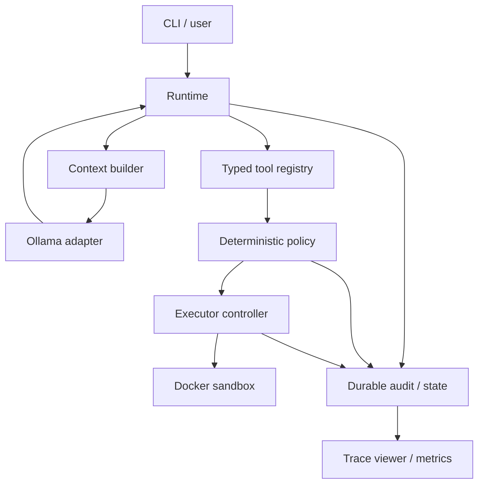

# Local Agent Harness: Architecture and Build Plan

Version 0.1 — October 6, 2026  
Owner: Ruthvik Vaila  
Status: implementation blueprint; the interfaces and CLI below are proposed, not implemented.

## 1. The first outcome

Build one local coding agent that can inspect a supplied repository, reproduce a failing test, edit the implementation, rerun tests, and return a diff plus a complete execution trace.

Use Python for the first runtime and executor. Run Ollama on your host, and execute model-generated commands and helpers in Docker. Keep the executor interface independent of models so it can later move to Rust or an AGX Orin worker.

Your workstation has an i7-14700, 48 GB RAM, and an RTX 6000 Ada with 48 GB VRAM. Start with one model request and one workspace mutation at a time. The harness is unlikely to be the main latency bottleneck; measure model queueing, loading, prompt processing, generation, and tools independently before changing languages.

The defining invariant is:

> No action is dispatched until its proposal, validation, authorization, and dispatch intent have been durably recorded. Every outcome links back to that record.

Observability is part of correctness. A dashboard is a view of this record, not its source.

## 2. Initial scope and defaults

| Item | Initial choice |
| --- | --- |
| Runtime | Python, explicit async control loop |
| Agent | One configurable coding agent |
| Provider | Ollama; selected locally installed model supplied in config |
| Executor | Docker only for agent-controlled filesystem and process operations |
| Core tools | `read_file`, `write_file`, `patch_file`, `list_files`, `search_files`, `run_command`, `git_diff` |
| Durable control state | SQLite on a local filesystem |
| Large state | Files: immutable request/response snapshots, logs, artifacts, checkpoints |
| Working memory | Agent-editable Markdown and JSON inside the sandbox workspace |
| Audit records | Protected SQLite events; JSONL is an exported view |
| Tracing | OpenTelemetry spans from the first implementation, local audit always retained |
| Interface | CLI first; UI later |
| Parallelism | One active run initially; tools executed in returned order |
| Sandbox network/GPU | Disabled by default |
| Model turns / calls | 30 model turns and 100 attempted tool calls maximum |
| Run deadline | 20 minutes, configurable |
| Model request timeout | 180 seconds, bounded by remaining run time |
| Command timeout | 60 seconds default, 300 seconds maximum |
| Execution resources | 4 CPU equivalents, 4 GiB RAM, 128 processes; verify enforcement |
| Context | Start at 8k; evaluate 32k against your measured latency and success rate |

These are starting settings, not model quality claims. Reserve output space within the configured context. Do not assume that a supported context length is useful for your task or affordable at your chosen quantization.

Defer multi-agent delegation, automatic helper promotion, RAG, remote workers, browser automation, and a Rust rewrite until the single-agent acceptance gates pass. Do not include a host-process executor as an automatic fallback.

## 3. Architecture and ownership



| Component | Owns | Must not do |
| --- | --- | --- |
| Runtime | Sequence, budgets, cancellation, terminal status | Execute generated code in its process |
| Context builder | Select and package model input with provenance | Silently drop constraints or tool exchanges |
| Model adapter | Translate requests and preserve provider responses | Authorize or dispatch tools |
| Tool registry | Versioned descriptions and strict schemas | Import helper code written by the model |
| Policy | Grant/deny/approval, fixed resource profiles | Let model arguments weaken isolation |
| Executor | Workspace operations, processes, limits, results | Decide the task's objective |
| Storage | Events, identities, immutable evidence, recovery | Treat sandbox files as trusted control state |
| Telemetry | Correlated spans and aggregate measurements | Be the only durable action record |

The controller necessarily has authority to create containers. That authority stays on the trusted side. The sandbox never receives the Docker socket, harness credentials, model-server credentials, audit directory, or permission configuration.

Docker provides useful isolation but shares the host kernel. Do not describe it as making arbitrary code impossible to escape. For stronger isolation against deliberately hostile code, evaluate a VM or stronger sandbox separately; keep that upgrade behind the executor interface.

## 4. Proposed repository layout

Use a package layout that keeps runtime data out of your source tree:

```text
local-agent/
  pyproject.toml
  README.md
  src/local_agent/
    cli.py
    contracts.py
    runtime/
      agent.py
      loop.py
      context.py
      budgets.py
      recovery.py
    models/
      base.py
      ollama.py
      scripted.py
    tools/
      registry.py
      filesystem.py
      command.py
      git.py
    policy/
      engine.py
      profiles.py
    executor/
      base.py
      docker.py
      worker.py
    workspace/
      manager.py
    storage/
      database.py
      blobs.py
      checkpoints.py
    observability/
      events.py
      spans.py
      metrics.py
      audit.py
  config/
    coder.yaml
  sandbox/
    Dockerfile
  tests/
    unit/
    integration/
    fixtures/broken_repo/
  docs/
    architecture.md
    tracing.md
    recovery.md
```

`contracts.py` defines your protocol, not a dependency on any particular model SDK. The `scripted` provider returns predetermined tool calls for repeatable tests without Ollama or a GPU. `worker.py` is trusted executor implementation, packaged into the sandbox image; it is not a plugin import directory.

## 5. Filesystem state, with a protected control plane

Choose a data root outside the repository, for example `~/.local/share/local-agent`. Use owner-only permissions for protected files and directories.

```text
data-root/
  control/
    agent.db
    runs/<run_id>/
      manifest.json
      checkpoints/
      context-manifests/
      snapshots/
      tool-results/
      artifact-manifests/
      events.jsonl
  sandboxes/<workspace_id>/
    project/
    memory/
      task.md
      plan.md
      findings.md
      summary.md
    tools/
    scratch/
    outputs/
```

Only `sandboxes/<workspace_id>` is mounted into the container, as `/workspace`. Never mount all of `data-root`, even read-only. The harness captures tool output outside this mount. An `artifact://...` reference is resolved by the harness under authorization, not by concatenating a model-supplied path onto a host directory.

There are three kinds of state:

| State | Authority | Examples |
| --- | --- | --- |
| Control and recovery | Harness, persisted in SQLite | Run status, tool attempts, approvals, pending operations |
| Evidence | Harness, immutable files referenced by records | Actual context sent, provider response, captured stdout, artifact hash |
| Working memory | Agent, explicitly untrusted | Plan, notes, generated helpers, source edits |

The filesystem remains first-class: heavy content lives in files and humans can inspect memory. SQLite does more than indexing because authorization and recovery need transaction boundaries. Markdown notes are never allowed to override the user goal, policy, or a recorded execution outcome.

Do not maintain independently authoritative SQLite and JSONL histories. Commit events and state transitions together in SQLite; export `events.jsonl` from committed events. If export fails, regenerate it later. Failure to commit the authoritative audit is different: stop dispatching new work.

## 6. Contracts to define before writing the loop

Implement immutable typed records with explicit schema versions. Pydantic is suitable for strict validation; reject unknown fields, unreasonable sizes, coercion of booleans into integers, and malformed paths. A JSON schema constrains shape; it does not authorize execution.

| Contract | Required information |
| --- | --- |
| `AgentConfig` | Agent ID, instructions version/hash, model alias, tool allowlist, policy profile, budgets |
| `RunManifest` | Run/thread/workspace IDs, source revision, package versions, effective config hash, model identity, sandbox image digest |
| `ContextSnapshot` | Ordered messages and tool definitions actually sent, blob refs, hash, provenance, exclusions, token estimate |
| `ModelRequest` | Request ID, trace context, context ref, provider/model, options, deadline, attempt |
| `ModelResponse` | Text, ordered proposed calls, finish status, provider usage, original response ref, request ID |
| `ToolCall` | Harness call ID, provider ID if supplied, request ID, index, tool name/version, original argument ref |
| `PolicyDecision` | Decision ID, call ID, allow/deny/approval, matched rule IDs, policy hash, normalized request hash |
| `ExecutionRequest` | Execution ID, call ID, workspace ID, tool/validated args, effective limits, trace context, authorization ref |
| `ExecutionResult` | Execution ID, status, nullable exit code, output refs, bounded preview, timings, truncation, side-effect status |
| `DecisionRecord` | Actor, decision kind, selected action, input/evidence refs, rule/config versions, rationale source |
| `ArtifactRecord` | Artifact ID, producing execution/run, immutable blob ref/hash, MIME, size, workspace origin |
| `Checkpoint` | Schema, completed event sequence, conversation refs, counters, pending IDs, workspace identity/version |

Generate your own call IDs even if Ollama returns only a name/index. Keep provider IDs separately. This avoids ambiguous traces when one response calls the same tool twice.

The model must not choose the workspace ID, mount path, image, Docker flags, GPU access, or an unrestricted environment dictionary. The trusted run configuration supplies those values.

A proposed executor boundary can look like this:

```json
{
  "schema_version": 1,
  "execution_id": "exec_0042",
  "tool_call_id": "call_0021",
  "workspace_id": "ws_0007",
  "tool": "run_command",
  "tool_version": 1,
  "arguments": {
    "argv": ["python", "-m", "pytest", "-q"],
    "cwd": "project",
    "timeout_seconds": 60
  },
  "effective_limits": {
    "memory_mb": 4096,
    "cpu_cores": 4,
    "pids": 128,
    "network": false,
    "gpu": false
  },
  "authorization_ref": "policy_0019",
  "trace_id": "4bf92f3577b34da6a3ce929d0e0e4736",
  "parent_span_id": "00f067aa0ba902b7"
}
```

This is a proposed internal protocol, not an Ollama wire request. Initially it can be an in-process interface. If the executor becomes a daemon, authenticate clients and validate the authorization binding; a supplied `authorization_ref` alone is not authority.

## 7. What “all decisions traceable” means

For every model-driven or deterministic runtime decision, retain the inputs available at that boundary, the selected action, the controlling configuration, and the outcome. This allows you to reconstruct behavior and challenge a decision with evidence.

It does not reveal every internal neural computation or guarantee that a model's explanation is its actual causal reasoning. Do not require private chain-of-thought. A concise model-supplied rationale is optional supporting data, marked `model_reported`, rather than a source of authority. Do not generate an explanation afterward and label it as the original rationale.

| Decision | Evidence to retain |
| --- | --- |
| Model selection | Candidate capability/config table, chosen model identity, routing rule |
| Context selection | Included/excluded item refs, ordering, budget, selection rule, summary lineage |
| Tool proposal | Exact response, call index/name, original arguments, associated context |
| Schema rejection | Validation errors, schema version, original argument ref |
| Authorization | Effective normalized arguments, policy rules/hash, verdict, approval binding |
| Execution scheduling | Ordered calls, resource profile, dispatch reason, remaining deadlines |
| Retry | Error category, prior attempt ID, retry rule, new attempt ID, backoff |
| Memory update | Previous/new content hashes, producing call, untrusted content label |
| Context compaction | Input refs, summarizer/config version, output ref, items removed |
| Helper reuse | Manifest/code hashes and versions actually executed, producing run |
| Completion | Model proposal, verification result, remaining budgets, final status |
| Recovery/cancellation | Checkpoint/event refs, inspected executor state, reconciliation choice |

A missing rationale need not block a valid tool call. Missing inputs or authorization evidence must block dispatch.

## 8. Trace schema and correlation

Use a run root span with child spans for model turns and operations. Keep a stable `run_id` across restart. A resumed process may create a new trace linked to the earlier trace; do not pretend an ended span continued across a crash.

Use OpenTelemetry-compatible 32-hex trace IDs and 16-hex span IDs. Propagate context through the executor API; do not expect Docker to propagate it automatically. Span parents represent one enclosing operation; causal links represent other dependencies, such as a tool output informing the next turn.

Use fixed span names such as `agent.run`, `context.build`, `model.generate`, `tool.validate`, `policy.evaluate`, `tool.execute`, `checkpoint.write`, and `run.verify`. Put tool/model names in attributes. Store large payloads in immutable blobs instead of span attributes.

An event envelope example:

```json
{
  "schema_version": 1,
  "event_id": "evt_0093",
  "run_id": "run_0007",
  "run_seq": 93,
  "timestamp_utc": "2026-10-07T04:10:22.102Z",
  "trace_id": "4bf92f3577b34da6a3ce929d0e0e4736",
  "span_id": "b9c7c989f97918e1",
  "parent_span_id": "00f067aa0ba902b7",
  "event_type": "policy.evaluated",
  "actor": "policy",
  "step_id": "step_0004",
  "tool_call_id": "call_0021",
  "caused_by": ["evt_0092"],
  "data": {
    "decision_id": "policy_0019",
    "decision": "allow",
    "rule_ids": ["workspace.only", "sandbox.offline"],
    "request_ref": "blob://request-0021",
    "request_hash": "sha256:example-placeholder",
    "policy_version": "dev-offline-v1",
    "reason": "Workspace command fits the granted offline profile.",
    "reason_source": "deterministic_rule"
  }
}
```

IDs and hash values in examples are illustrative. Production hashes are real SHA-256 digests of stored bytes or a documented canonical JSON encoding. `run_seq` is strictly increasing within one run and assigned transactionally, not derived from timestamps. Measure durations with a monotonic clock; use UTC for display and correlation.

Required event families:

| Family | Minimum events |
| --- | --- |
| Run | `run.created`, `run.started`, `run.resumed`, `run.stopped` |
| Model/context | `context.built`, `context.compacted`, `model.selected`, `model.requested`, `model.responded`, `model.failed` |
| Tool proposal | `tool.proposed`, `tool.validated`, `tool.rejected` |
| Policy | `policy.evaluated`, `approval.requested`, `approval.resolved` |
| Execution | `execution.dispatch_intent`, `execution.started`, `execution.finished`, `execution.reconciled` |
| State | `memory.changed`, `artifact.registered`, `checkpoint.committed` |
| Control | `retry.decided`, `cancel.requested`, `budget.exhausted`, `completion.proposed`, `completion.verified` |

`execution.finished` includes failure, timeout, cancellation, and output-limit termination. A crash can leave an attempt without that event; recovery records a reconciliation outcome. Do not fabricate a successful terminal event to make a trace look complete.

## 9. Durable audit versus performance telemetry

Implement both immediately:

1. A synchronous durable event writer for decisions, authorizations, and dispatch intents. It must commit successfully before execution.
2. OpenTelemetry spans/metrics for timings and visualization. Export failures should not erase local evidence or stall cleanup.

Use 100% local audit capture. If a later tracing backend samples spans, mark its coverage explicitly. Sampled traces cannot be your complete decision history.

Required metrics include run success/verified success, terminal reason, validation failures, policy denials, attempted calls, command exits/timeouts, context size, compactions, model latency, tool latency, and captured bytes. Avoid run IDs or artifact IDs as metric labels; those belong in traces and logs.

For your model benchmarks, retain provider-reported token counts and durations alongside client-observed timings. Ollama exposes prompt/evaluation and load timing fields in chat responses. Calculate token rates only when the count and corresponding duration are both available and the duration is nonzero. Missing usage is `null`, not zero.

Start with non-streaming requests. In the streaming phase, measure first response chunk separately from first visible text: thinking/tool-only chunks can arrive earlier. Record queueing only when you can measure it; otherwise report client total minus known phases as unexplained residual, not a claimed queue time.

Privacy contract: protected snapshots may contain private repository contents. Never log authorization headers or inherit the complete host environment. Keep routine telemetry payload-free. Default source snapshots stay local; external exporters receive only allowed metadata. Redaction changes the claim: a redacted snapshot is not byte-for-byte replay evidence. Record capture mode and omitted-field metadata.

If SQLite cannot commit an audit event, dispatch no new model or tool work. Best-effort cancel active execution and report `audit_unavailable`. Emergency cleanup must remain possible even when logging is broken; reconcile its outcome afterward. Bound local queues and output storage so observability cannot exhaust host memory.

## 10. Storage and crash consistency

Start with these tables:

| Table | Important fields |
| --- | --- |
| `runs` | IDs, status, effective config ref, latest checkpoint, timestamps |
| `events` | Event ID, run ID, unique run sequence, type, causal refs, trace/span IDs, data |
| `model_requests` | Request/step IDs, snapshot refs, status, attempts, usage |
| `tool_calls` | Call/request IDs, tool/schema version, argument refs, validation status |
| `policy_decisions` | Decision/call IDs, request hash, policy hash, verdict, approval ref |
| `execution_attempts` | Execution/call IDs, attempt, dispatch state, container identity, result refs |
| `artifacts` | Artifact/run/execution IDs, blob hash, size, MIME, source path |
| `checkpoints` | ID, run ID, event sequence, manifest ref/hash |
| `approvals` | ID, request/profile hash, scope, expiry, state, actor |

Use foreign keys, unique IDs, and a unique `(run_id, run_seq)` constraint. Keep SQLite transactions short; never hold one while waiting for inference or a command. Use WAL on a local disk, a busy timeout, and an appropriate durability configuration such as `synchronous=FULL`. Check actual settings at startup. WAL is unsuitable for a database shared over a network filesystem.

Write immutable blobs before committing records that reference them. Write to a unique temporary file on the same filesystem, flush and fsync it, atomically rename it, and fsync the parent directory for the intended Linux crash-durability guarantee. Atomic rename alone does not guarantee persistence after power loss. A crash before the DB commit leaves an orphan blob; clean it later. Avoid the opposite ordering, which leaves authoritative records pointing to missing evidence.

Use one writer per run, with a lock/lease preventing two harness processes from resuming it. Do not let multiple agents overwrite one checkpoint. Every format has a schema version and migration policy; never silently load a newer incompatible checkpoint.

Persist a proposed model response before accepting any contained action. Assign and persist all tool call IDs. Commit authorization and dispatch intent before launching a container. Capture the result, persist its blob, then commit the result and conversation update. Export JSONL afterward.

There is no atomic transaction spanning SQLite, Docker, and filesystem mutations. An execution can perform a side effect and crash before recording the result. Represent that uncertainty rather than claiming exactly-once execution.

## 11. Seven initial tools

| Tool | Proposed arguments | Behavior |
| --- | --- | --- |
| `read_file` | Exactly one of relative path or authorized evidence ref; line offset/limit | Bounded text and metadata; binary files rejected or described |
| `write_file` | Relative path, content, expected prior hash or explicit create-only | Atomic replacement inside sandbox; report hashes |
| `patch_file` | Relative path, exact old/new text, expected hash | Require one exact match; conflict rather than silent approximation |
| `list_files` | Relative directory, depth, limit | Bounded listing, explicit continuation |
| `search_files` | Literal query, relative directory, limit | Literal matching initially; bounded results |
| `run_command` | `argv`, relative cwd, requested timeout | Execute inside configured sandbox; never shell-evaluate on host |
| `git_diff` | Relative repository path, optional file paths, output limit | Fixed git invocation in sandbox; disable external diff/textconv |

Use one documented path convention: relative to `/workspace`. Reject absolute paths, parent traversal, NULs, and paths outside approved subdirectories. For filesystem tools, default writable directories are `project`, `memory`, `tools`, `scratch`, and `outputs`.

Path validation happens inside the executor where the file is opened. A host `Path.resolve()` check followed by a later open is vulnerable to symlink races. Initially disallow symlink traversal in typed filesystem tools and use descriptor-relative operations; do not follow attacker-controlled links on the host while scanning output. Arbitrary commands may operate freely within the container's granted filesystem, so command security comes from isolation, not a path blacklist.

Pass argv as an array to process creation. A model can still run `python -c` or a shell inside the container; argv is not a defense against arbitrary behavior there. Do not claim you can reliably enforce “delete fewer than 100 files” using command text inspection when arbitrary code execution is available.

Make policy match the permissions actually enforceable: workspace-only mounts, fixed network access, no host secrets, resource limits, and approved tools. Specialized tools can enforce narrower behavior when needed.

All tools, including reads, are traced. Preserve original and normalized arguments separately. Unknown tools and invalid arguments produce a structured error back to the model and consume the attempted-call budget.

## 12. Docker executor design

For v0, use one short-lived container per tool invocation, sharing that run's persistent workspace. This makes timeout cleanup straightforward: stop and then kill the whole invocation container, including descendants. Interpreter and dependency caches can be part of the prebuilt image. Evaluate startup cost before introducing a long-lived container.

The profile must include:

- A pinned image digest with preinstalled Python, Git, search utilities, and fixture-test dependencies.
- An explicit non-root user with known write access to the mounted workspace; test UID mapping for your Docker mode.
- Read-only root filesystem and bounded writable tmpfs for `/tmp`.
- Only the selected workspace bind mount or named volume.
- No network, no GPU, no privileged mode, no Docker socket, no host PID/network namespaces, no added devices.
- Dropped Linux capabilities, `no-new-privileges`, and the default seccomp profile enabled.
- CPU, RAM, process limits, and a swap policy where supported.
- Fixed minimal environment and working directory, with trusted resource values clamped by policy.

Prefer rootless Docker where compatible with the required limits and workspace mapping. Rootless resource controls depend on the host configuration; verify cgroup enforcement rather than assuming flags worked. A rootful controller should still launch a restricted, non-root container.

Build the image and provision repository dependencies outside the agent loop under your control. An offline agent cannot clone an internet repo or install internet dependencies. Supply a local copy of the repository. A future network-enabled profile is a separate explicit grant; host-only inference access does not require sandbox networking.

Keep the NVIDIA GPU reserved for Ollama initially. Generated code does not need a GPU merely because its authoring model uses one.

Store container labels tying execution/run IDs to dispatch intents. Inspect effective configuration before execution and retain an attestation ref. If a requested protection cannot be enforced, reject the run; do not fall back to host execution.

Capture stdout and stderr concurrently with bounded buffers. Example defaults: 16 KiB preview per stream, 10 MiB captured output per invocation, 1 GiB total run evidence budget. At the capture cap, record truncation and terminate the offending invocation; do not simply stop draining its pipe and cause a deadlock.

Workspace disk growth requires a separate control. Docker memory limits do not cap a bind-mounted directory's disk usage. Use a verified filesystem/project quota for a hard bound; a free-space monitor with cancellation is only a soft bound and must be described that way. Record which guarantee is active.

Use a small trusted worker for typed filesystem operations. Invoke it in an isolated interpreter environment with fixed import paths; never import agent-generated files from the workspace. Preserve safety even if the agent creates `json.py`, `sitecustomize.py`, or executable hooks in its repository.

Named volumes are valid alternatives to bind mounts, but neither is inherently safer if the granted content is identical. Bind mounts simplify human inspection; named volumes require an explicit export path for artifacts and debugging. The mount scope is the important boundary.

## 13. The loop and its state machine

Terminal run statuses: `verified`, `completed_unverified`, `failed`, `cancelled`, `budget_exhausted`, `needs_reconciliation`, and `audit_unavailable`. Waiting for approval is a nonterminal suspended state.

At every boundary, the runtime first checks cancellation and remaining budgets. A conceptual loop is:

```python
# Pseudocode: methods must implement the durable contracts described here.
async def run(agent, state):
    while True:
        await check_cancel_and_budgets(state)
        snapshot = await context.build_and_persist(state, agent)
        request = await store.record_model_request(snapshot, agent)
        response = await provider.generate(request)
        await store.persist_response_and_calls(request, response)

        if not response.tool_calls:
            return await verify_or_mark_unverified(response, state)

        for call in response.tool_calls:
            await check_cancel_and_budgets(state)
            validated = await registry.validate_and_record(call)
            if not validated.ok:
                await store.append_tool_error(call, validated.error)
                continue

            decision = await policy.evaluate_and_record(validated, state)
            if decision.requires_approval:
                return await suspend_for_bound_approval(call, decision)
            if not decision.allowed:
                await store.append_tool_error(call, decision.reason)
                continue

            attempt = await store.commit_dispatch_intent(validated, decision)
            result = await executor.execute(attempt)
            await store.persist_result_and_conversation(attempt, result)

        await checkpoints.commit(state)
```

Actual implementation wraps provider/executor calls in bounded deadlines and exception handling, records failures, and ensures cleanup in `finally`. A transport failure is not an empty final response. A tool timeout is not exit code zero. A response containing both text and tool calls dispatches the validated calls before considering completion.

Execute multiple calls sequentially initially, retaining the assistant's complete call list and one correlated tool result for each call. On cancellation or budget exhaustion, record unresolved/skipped calls explicitly; never dispatch them just to complete the exchange.

Retry transient model transport failures at most twice with bounded backoff and a new request attempt ID. Do not automatically retry failed tools or commands. A command may already have changed files even if its response was lost. Let the model inspect known results, or stop for reconciliation when the effect is unknown. Repeated identical failed actions should stop after a configured threshold, with hashes and the stop rule recorded.

Approvals bind to the exact normalized request hash, workspace, policy profile, limits, and expiry. Changing the command after approval invalidates it. Implement these records now; an interactive approval UI can wait. In the offline v0 profile, unsupported capabilities are denied rather than implicitly granted.

## 14. Ollama adapter and model capability checks

Use the native `/api/chat` tool-calling interface initially. Construct versioned JSON schemas explicitly instead of letting SDK reflection define your public contract. Preserve the complete assistant message and append correctly named tool results in the follow-up exchange. Do not extract tool calls from arbitrary prose with regex as a silent fallback.

Start with `stream: false`. Later, accumulate and validate the completed stream before dispatching tools; incomplete fragments must never execute. Preserve provider fields necessary to continue the conversation without presenting optional thinking output as authoritative decision evidence.

At startup, record Ollama version, locally installed model identity/digest where exposed, quantization metadata, configured context/options, and available capability metadata. Then perform a small capability test: valid tool selection, argument schema adherence, tool-result continuation, and sensible stopping. Provider metadata alone does not prove reliable agent behavior.

Do not assume a model name mentioned in prior conversation corresponds to a valid installed tag. Use the exact tag reported by your local installation and store the model identity with the run. If identity cannot be established, mark reproducibility as incomplete.

Normalize provider outputs into your contracts, while preserving raw response evidence locally. Add other adapters only after common contract tests pass. “Codex” can help develop and test this repository initially; integration as a nested coding agent is separate work and must define its own tool authority and tracing boundary.

## 15. Context and filesystem memory

Build model input from protected task instructions, current trusted configuration, bounded working-memory excerpts, recent complete exchanges, selected file/tool evidence, and current tool schemas. Working-memory text and repository content are data, even when they contain instructions addressed to the agent.

For every request, save the actual ordered payload and a manifest showing each item's origin, version/hash, inclusion reason, and size. Record exclusions by reason: stale, duplicate, over budget, irrelevant, or prohibited. A prompt hash alone is insufficient to reconstruct model input.

Example starting allocation for an 8k window: reserve 2k for output and fit all input, including tools, within 6k. These are estimates until reconciled with actual provider counts. Use a conservative tokenizer estimate and safety margin; do not silently rely on provider truncation. If fixed instructions plus schemas cannot fit, fail clearly or explicitly choose a larger configured context.

Store raw tool output externally and return a bounded preview with a structured retrieval reference, offset, and truncation status. Support authorized retrieval of additional slices through the read contract before claiming progressive disclosure is complete. Keep protected evidence out of the sandbox mount; the read handler resolves permitted references explicitly.

For v0, use deterministic output clipping and bounded recent exchanges. Never discard part of an assistant tool-call/result group. Add summarization only in the context milestone: record its source refs, model/options or deterministic rule, resulting content, and preserved constraints. Keep the original evidence. Summaries are derived working memory, not facts overriding captured results.

## 16. Agent-generated helpers and reuse

Allow scripts under `/workspace/tools`. Run them through `run_command` in the same sandbox profile. Do not dynamically import, execute, or inspect them using the host Python process.

Keep helper discovery separate from core tool registration. Initially the agent finds a helper manifest using `list_files`, reads it, and executes its argv. You can later add a small discovery interface that returns names/descriptions without sending every helper schema on every turn.

A proposed helper manifest:

```json
{
  "schema_version": 1,
  "name": "extract_test_failures",
  "description": "Extract failure names from a saved pytest log",
  "entrypoint": ["python", "tools/extract_test_failures/main.py"],
  "inputs": {"log_path": "relative workspace path"},
  "requested_capabilities": [],
  "version": "0.1.0"
}
```

The manifest is untrusted metadata. It cannot grant network, host, GPU, or credential access. Descriptions can contain prompt injection; treat them as data and limit their size.

When a helper is reused, record the manifest/code hashes immediately before execution and the execution image digest. For reproducible shared reuse, the harness copies reviewed bytes to an immutable versioned package; each run receives a read-only copy. Review and version helpers before sharing broadly. Review does not require promoting them into privileged host tools: many useful helpers should remain sandboxed permanently.

## 17. Completion, replay, and recovery

Completion has two independent claims: the model says it is done, and the harness has verification evidence. A no-tool response creates `completion.proposed`. For the broken-repo fixture, the harness runs a fixed verification command and protected tests in a clean verification workspace containing the candidate code. Agent-editable tests are not independent proof.

If that check passes, status is `verified`; otherwise continue within budgets or fail. For general tasks lacking a verifier, return `completed_unverified` with the model's answer and available evidence. Never mark all tasks successful merely because the model stopped calling tools.

Define three different operations:

| Operation | Meaning | Executes code? |
| --- | --- | --- |
| Trace inspection | Reconstruct recorded inputs, decisions, and outcomes | No |
| Recorded replay | Feed captured model/tool responses through the runtime to test state transitions | No real tools; mocks only |
| Fresh rerun | Run the task again with a new run ID and workspace | Yes, subject to policy |

Saved inputs do not guarantee identical fresh inference, even with temperature zero. A metadata-only or redacted capture further limits replay. Display those limitations.

On restart, acquire the run lock, load the last compatible checkpoint, and reconcile later committed events. Inspect labeled executor containers and captured result blobs before changing status.

| Pending situation | Recovery action |
| --- | --- |
| Model request has no persisted response | Retry with a new attempt; note possible duplicate computation |
| Tool proposal recorded, no dispatch intent | Revalidate current policy and decide whether to dispatch |
| Dispatch intent recorded, no terminal result | Inspect executor; do not assume it never ran |
| Container still active | Apply recovery policy: observe/wait within deadline or terminate; record choice |
| Container ended, outcome recoverable | Capture evidence and record reconciled result |
| Container missing, effect unknown | `needs_reconciliation`; no automatic replay of mutating call |
| Result committed, checkpoint missing | Rebuild state from committed records without rerunning the tool |

Retain ended containers until the result is durably committed, then remove them. Do not use unconditional auto-removal if recovery depends on inspecting exit status. An execution ID helps correlate work; it does not itself make commands idempotent.

Git diffs/commits can checkpoint source changes, but they do not restore all filesystem content or external side effects. On v0's offline profile, preserve baseline code and the final diff. Record generated artifact bytes and hashes independently of Git.

## 18. Implementation milestones and acceptance gates

Work in this order. Time estimates are focused engineering sessions, not deadlines; move on only when the gate passes.

| Milestone | Approx. effort | Deliverable | Acceptance gate |
| --- | --- | --- | --- |
| M0: contracts and trace core | 2–3 sessions | Typed records, SQLite migrations, blob store, events/spans, scripted provider, trace reader | Simulated decisions reconstruct fully; audit commit failure prevents dispatch |
| M1: isolated executor | 2–4 sessions | Workspace manager, pinned image, seven tools, limits/cancellation | Generated code stays in the granted mount; timeout kills descendants; protected records inaccessible |
| M2: real agent loop | 2–3 sessions | Ollama adapter, budgets, strict schemas, sequential multi-call handling | Agent repairs fixture with independent verification and a complete trace |
| M3: durable restart | 2–3 sessions | Checkpoints, leases, reconciliation, recorded replay | Crash tests never silently replay an uncertain mutation |
| M4: context and helpers | 2–3 sessions | Bounded output retrieval, traced compaction, helper manifests/reuse | Large outputs remain usable without context overflow; reused helper version is identifiable |
| M5: evaluate and operate | 2–3 sessions | Repeatable task suite, reports, startup checks, backups, optional local trace UI | Compare model/context choices by verified task success, latency, and failure modes |

### M0 tasks

1. Create the package, strict contracts, and immutable ID types.
2. Define allowed state transitions and event families before adding execution.
3. Implement SQLite event/state commits and local blob publication.
4. Instrument each boundary with spans and store span IDs in audit events.
5. Build a scripted scenario: propose read, propose test, validation error, policy denial, final response.
6. Implement trace inspection and an audit validator.

Test missing evidence, invalid foreign keys, duplicate sequences, and storage failure. The first shipped feature is a correct trace of a mock run, not a live model call.

### M1 tasks

1. Create run/workspace directories with narrow ownership and mount scope.
2. Build and pin the offline sandbox image with fixture dependencies.
3. Implement hardened filesystem worker operations and command execution.
4. Clamp timeouts and resource profiles outside model control.
5. Capture concurrent output, enforce caps, and implement cancellation.
6. Verify actual container settings and all safety invariants.

Test traversal, symlink handling, workspace import shadowing, socket/host-secret absence, missing image, unsupported limits, runaway children, and output floods. Use harmless sentinel host files instead of real secrets.

### M2 tasks

1. Implement provider capability checks and preserve raw request/response evidence.
2. Wire strict call validation, deterministic policy, and durable dispatch intents.
3. Count attempted calls and turns before executing them.
4. Return structured errors for invalid/denied calls.
5. Add independent fixture verification and final diff reporting.

Run the live fixture several times. Do not require identical model text; require truthful terminal statuses and complete evidence. Keep runtime tests deterministic through the scripted provider.

### M3 tasks

Inject crashes after response persistence, dispatch intent, container launch, result publication, and result commit. Verify every recovery branch in section 17. Rebuild the JSONL export from SQLite and ensure trace inspection never invokes real tools.

### M4 tasks

Generate a large log; retrieve a later slice through an authorized reference. Force compaction and inspect its lineage. Create and reuse a helper; change its code and confirm its version/hash changes in the trace. Ensure working-memory edits cannot alter policy.

### M5 tasks

Use a held-out task set rather than a single successful demo. Compare installed model/quantization/context profiles on verified success, invalid-call rate, recovery attempts, total wall time, prompt/decode performance, context size, and VRAM. Record warm versus cold model state. Monitor thermals for sustained workloads and retain measurements with the run; your earlier workstation heat concerns make long repeated tests worth measuring explicitly.

Change one major dimension at a time. Avoid picking a central model solely from tokens per second or advertised parameter count. Tool adherence and end-to-end task success are essential.

## 19. Suggested CLI and developer workflow

These are target commands for your implementation, not commands available today:

```bash
local-agent doctor
local-agent run --agent config/coder.yaml --repo /path/to/repo --task-file /path/to/task.md
local-agent trace <run_id>
local-agent audit <run_id>
local-agent replay <run_id> --recorded-only
local-agent resume <run_id>
local-agent cancel <run_id>
local-agent export <run_id> --output /path/to/run-bundle
```

`doctor` checks model connectivity/capability, image identity, mount permissions, configured limits, audit database settings, available disk/quota, and telemetry initialization. It does not silently loosen restrictions to make checks pass.

A proposed configuration keeps all limits visible. Replace the model placeholder with an installed tag before running the future CLI; validate this file against `AgentConfig` at startup.

```yaml
schema_version: 1
agent_id: coder
provider: ollama
model: "REPLACE_WITH_LOCAL_INSTALLED_TAG"
instructions_version: coder-v1
tools: [read_file, write_file, patch_file, list_files, search_files, run_command, git_diff]
policy_profile: dev-offline-v1
limits:
  max_model_turns: 30
  max_attempted_tool_calls: 100
  run_timeout_seconds: 1200
  model_timeout_seconds: 180
context:
  window_tokens: 8192
  output_reserve_tokens: 2048
observability:
  local_audit: required
  local_capture: full
  telemetry_payloads: false
  local_trace_sampling: 1.0
```

The effective configuration also resolves the immutable instruction content, policy definition, sandbox image digest, and model identity. Persist that resolved manifest; a YAML filename alone is insufficient provenance. These are proposed project field names, not provider API options.

`trace` should show model/context evidence, proposals, policy outcomes, actual executions, artifacts, and the final verification. `audit` reports missing refs, hash mismatches, unauthorized dispatches, unexplained pending attempts, and terminal states without required evidence.

The audit validator should enforce at least these relationships:

1. Every dispatch has a successful schema validation and an `allow` decision bound to the same normalized request hash and effective policy.
2. Every accepted model call links to the persisted response and the exact input snapshot, including tool schema versions.
3. Every result preview links to an existing captured blob or an explicit omitted/truncated capture record.
4. Every run marked `verified` links to a passing independent verification execution; every unresolved dispatch is reconciled or visibly pending.

Run this validator after each deterministic integration scenario and on exported bundles. An append-only convention and hashes detect some corruption; they are not tamper-proof against the owner of the host. Do not claim cryptographic audit authenticity without an additional protected signing or external anchoring design.

`export` creates a self-contained, explicitly classified bundle. Protected source content requires intentional inclusion. Prefer online SQLite backup tooling to copying only the live `.db` file: WAL state may contain recent commits. Export a consistent backup and referenced immutable blobs together.

During development, use Codex to implement one milestone at a time. A suitable first instruction is:

> Implement M0 from this guide only. Build strict contracts, SQLite migrations, immutable local evidence storage, a durable event writer, OpenTelemetry boundary spans, a scripted provider, and CLI trace/audit inspection. Do not add live command execution yet. Include meaningful tests proving that an audit commit failure prevents dispatch, causal IDs remain consistent, and recorded replay does not execute real tools. Report the implemented scope and test results.

Then implement M1 with the existing contracts, rather than inventing a second executor protocol. Review every phase against its acceptance gate before allowing live autonomy.

## 20. Definition of done for v0

- A supplied local fixture is inspected, repaired, and independently verified.
- Every model input and output is captured under the configured local capture policy.
- Every attempted tool call has validation and policy evidence or a recorded rejection.
- Every dispatched execution links to a durable allowed decision and exact normalized request.
- Tool output previews link to retained evidence or explicit truncation records.
- Context selection, retries, compactions when enabled, and terminal decisions are traceable.
- Commands and helper code run only in the restricted executor profile.
- Sandbox edits cannot modify audit records, approvals, or effective policy.
- Cancellation and timeouts terminate execution descendants and record outcomes.
- Crashes produce recoverable records or explicit uncertainty, never invented success.
- Trace inspection and recorded replay are read-only with respect to real execution.
- The final result includes diff/artifact references, verification status, and run ID.

## 21. Open choices to revisit after v0

| Choice | Evidence that justifies revisiting it |
| --- | --- |
| Rust executor | Measured controller bottleneck, process-lifecycle complexity, stronger independent boundary |
| Long-lived containers | Container startup is a material fraction of wall time; descendant cleanup is solved |
| Named volumes | Export/inspection workflow is acceptable and workspace ownership is simpler |
| AGX Orin worker | Specific ARM/native-device workload with an authenticated, traced executor protocol |
| Multi-agent runtime | Single agent works reliably and tasks have measurable independent subtasks |
| External trace UI | Local audit remains complete and external metadata/privacy policy is defined |
| Network-enabled tools | Concrete task need plus enforceable egress/credential policy |
| Shared helper catalog | Useful helpers have versioned immutable packages and clear provenance |

## 22. Primary references

Checked October 7, 2026 UTC. The implementation architecture and defaults above are recommendations for this project, not requirements imposed by these sources.

- [Ollama tool calling](https://docs.ollama.com/capabilities/tool-calling): assistant call preservation and tool-result continuation; streaming assembly.
- [Ollama chat API](https://docs.ollama.com/api/chat): request/response fields and reported inference timings.
- [OpenTelemetry traces](https://opentelemetry.io/docs/concepts/signals/traces/): spans, context, events, and causal links.
- [Docker container run reference](https://docs.docker.com/reference/cli/docker/container/run/): execution/isolation and resource configuration.
- [Docker resource constraints](https://docs.docker.com/engine/containers/resource_constraints/): supported CPU and memory controls.
- [Docker rootless mode](https://docs.docker.com/engine/security/rootless/): non-root daemon/container operation and host prerequisites.
- [SQLite WAL](https://www.sqlite.org/wal.html): write-ahead logging, concurrency, durability, and filesystem constraints.
