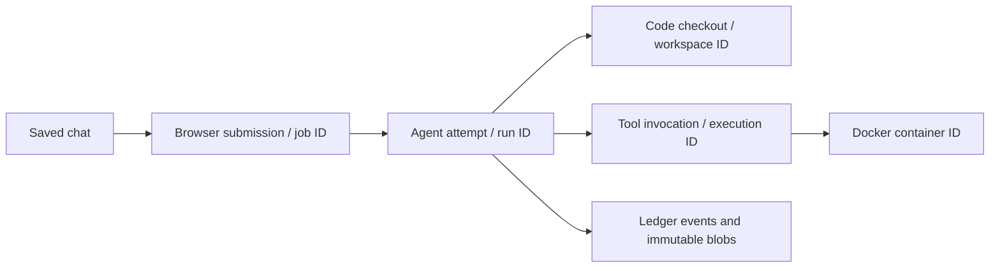

# Finding chats, workspaces, traces and containers

For the normal browser, start with **one data root**:
`~/.local/share/local-agent/`. The coder profile does not select another data
root. The browser server's `--data-root` selects where all its jobs are recorded.

The default is hardcoded in `src/local_agent/cli.py` to the conventional Linux
per-user application-data location. It keeps generated state outside the source
checkout and survives restarting or upgrading the harness. The current CLI does
not derive this default from `XDG_DATA_HOME`. Override it with the global option:

```bash
uv run --locked local-agent --data-root /path/to/private-state browser-web
```

Use `cd ~/.local/share/local-agent`, without `*`. The wildcard matches many
independent directories and is not a single combined application directory.

## What is stored where

All paths below are relative to the selected data root:

| Path | Purpose |
| --- | --- |
| `phone/threads/<chat-id>/thread.json` | Saved browser conversation and reply metadata; the legacy `phone` name is retained for compatibility. |
| `phone/jobs/<job-id>/` | One browser submission: `request.json`, frozen `config.json`, `status.json`, and optional progress/review reports. |
| `phone/loops/<loop-id>/` | Durable cycle state, explicit paid authorization/limits, frozen local/reviewer configs, stage job IDs and outcome history. |
| `control/agent.db` | Authoritative SQLite ledger: runs, events, model requests, tool calls and execution attempts. |
| `control/blobs/` | Immutable evidence: exact model inputs/outputs, tool results, stdout/stderr, checkpoints and artifacts. A `blob://…` is an evidence reference, not a separate trace directory. |
| `control/runs/<run-id>/events.jsonl` | Derived event export for a run. SQLite and blobs remain authoritative. |
| `control/git-workspaces/<workspace-id>.json` | Repository, agent branch, worktree, latest run and published candidate mapping. |
| `sandboxes/<workspace-id>/project/` | Actual editable code, generally a managed Git worktree. |
| `control/containers/<workspace-id>.json` | Persistent container ID, owner, image/settings, state, last execution and idle timeout. |
| `control/attempts/<execution-id>.*` | Execution-to-container mapping and published-result references. |
| `control/test-environments/` | Cached dependency-image specifications and installed-version records; Docker stores image layers separately. |

Server logs, including the current pairing code, are operational logs. They are
not the run trace database. Development launches currently record their active
log path in `phone/server-process.json`; treat pairing logs as private.

## The IDs have different lifetimes



A chat contains many submissions. A submission usually has one coding run;
workspace review can also have separate check and reviewer runs. Every **Continue
task** creates a fresh run ID while retaining the workspace ID and worktree.
Each tool execution gets its own execution ID. A persistent container can serve
many tool executions. These IDs do not mean there are many copies of the code.

The model runs through Ollama or the configured provider on the host side. It
does not live inside Docker. It requests file reads/searches/commands; Docker
executes those tools against the mounted workspace. Disk files preserve code and
artifacts, but they do not automatically reconstruct the model's goals, decisions
or chat history. The model still needs a concise task and pointers to relevant
evidence. **Fix with local model** saves review evidence in
`scratch/repair-review.json` and points the repair task at it, so the full review
does not depend on recent-chat limits.

## Persistent containers and continuation

Persistent mode reuses one healthy compatible keeper per workspace **across tool
calls and Continue tasks**. `/tmp` and background process state survive these boundaries;
shell `cd` and environment exports do not, because each command is a new process.
The host workspace is mounted at `/workspace`; code is at `/workspace/project`.
It is stored on the host and survives removal of the container.

The keeper is paused under a workspace lease while the controller captures
consistent baselines and completes independent checks/candidate publication. It is then
unpaused, retaining its processes. A recovered interrupted snapshot can be unpaused
without replaying a tool mutation. A committed result is reconciled before reusing
an execution that was interrupted at the controller boundary. Expiry, an unhealthy
container, or incompatible image/resource settings causes replacement. Switching
to ephemeral mode stops the old keeper. Files remain on the host in all cases.
Background jobs retain their state but are suspended during these guards,
including the bounded independent-check duration.

Persistent keeper names now use `local-agent-<owner-prefix>-<workspace_id>`,
where the workspace ID already starts with `ws_`. The owner prefix
separates data roots. Compatible legacy UUID-named keepers are renamed on their
next idle reuse, preserving the container ID. Active work is not renamed by a
background migration. Lookup still verifies the exact container ID, host manifest,
ownership labels, mounts and security settings. Persistent labels omit a
fixed run ID because a keeper's executions can have different run IDs.
Ephemeral tool/check containers retain execution-based names and are removed
after their invocation.

Independent test/reviewer copies use ephemeral containers, so repeated loop
iterations do not consume the coding workspace's persistent-container capacity.
Idle expiry and capacity are per data-root owner, not globally across every
development/test root. Test roots can therefore leave multiple keepers visible
in Docker. They should be expired or cleaned up; their presence is not evidence
that the browser created one container for every chat message.

```bash
uv run --locked local-agent --data-root ~/.local/share/local-agent containers list
```

See [executor lifecycle](executor.md) for cleanup/stop commands and exact current
reuse and recovery rules. Do not remove a workspace or data root merely to stop
a container.

## Where the other local-agent directories came from

`local-agent-development/` holds task briefs, isolated source snapshots, review
artifacts, validation logs and earlier source archives. It is a development
convention, not another required browser state directory. Its subdirectories
can themselves contain isolated harness data roots.

`local-agent-mcp/` is the MCP bridge's separate default root. Earlier directories
such as `local-agent-browser-build`, `local-agent-config-cleanup-*`,
`local-agent-executor-*` and `local-agent-trace-build` were explicit isolated
authoring/test roots. They are historical development evidence, not directories
every new project needs. Nothing automatically combines or migrates their
ledgers. [Repository layout](repository-layout.md) records earlier archives.

## Finding a browser failure

The saved chat now includes a **Workspace** panel with its repository/worktree,
current attempt, container name/state, ledger and trace paths, and prior jobs.
Failed attempts remain in the chat. Expand an attempt to see captured tool failures
or select **View this attempt trace**; this also resolves a live controller's run
from its progress file. **Continue this workspace** fills in the coding configuration
and workspace fields. **Stop container** is an explicit idle-workspace action;
stop an active loop first. Ordinary continuation carries bounded earlier goals,
failures and checks in `scratch/task-context.json` instead of relying only on chat.

1. Open the saved chat. **Show / hide trace events** displays linked run events.
2. Use the reply's run ID in the [trace viewer](traces.md). Choose the same data
   root as the browser server, normally `~/.local/share/local-agent`.
3. Inspect the failed tool's arguments and retained result. The final controller
   error is often only the stopping rule, not the underlying tool error.

From the harness checkout:

```bash
uv run --locked local-agent --data-root ~/.local/share/local-agent report RUN_ID
uv run --locked local-agent --data-root ~/.local/share/local-agent trace RUN_ID --json
```

The existing trace viewer also supports registering other data roots using
**Add location**, without moving any source ledger or evidence.

### Investigated example: failed text_stats continuation, 2026-10-28

- Chat: `fad73a575e449de2127026da76d12070`
- Latest failed browser job: `45c04f482103aa2e23bfdfa4e2daa41a`
- Latest failed run: `run_911ad87b40fc41389ad020168ca5ca44`
- Workspace: `ws_f35d604ad3c5414597fefe7dc9f12b7e`
- Job record: `phone/jobs/45c04f482103aa2e23bfdfa4e2daa41a/status.json`
- Edited code: `sandboxes/ws_f35d604ad3c5414597fefe7dc9f12b7e/project/`

The captured failed actions target
`project/tests/fixtures/broken_repo/text_stats.py`: `patch_file` returned
`patch requires one exact match`, and `write_file` returned
`create-only target already exists`. The controller stopped after its repeated
identical-failure limit. This is an editing/tool-use failure, not a Docker test
failure or missing Python package. The workspace remained `editing` with no new
published candidate. Earlier candidate reviews do not automatically approve
these pending changes. This section records the observed incident, not a claim
that the candidate was repaired.
